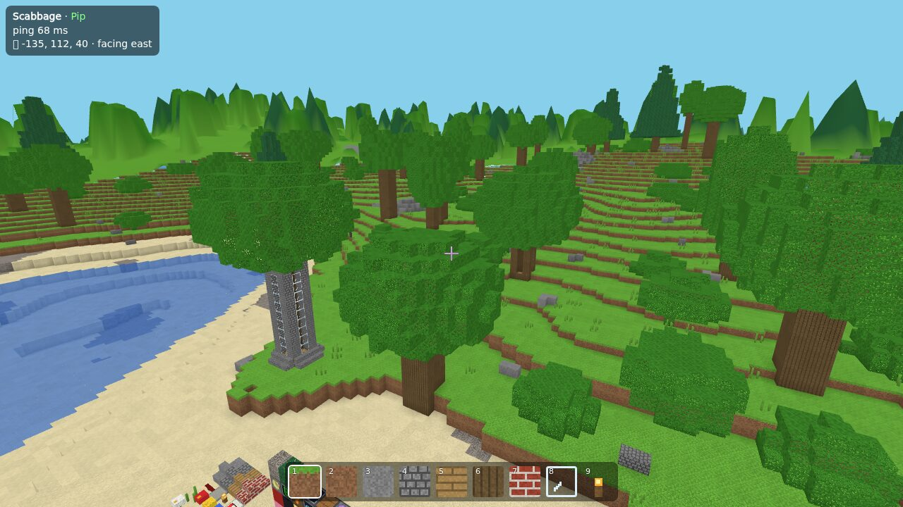
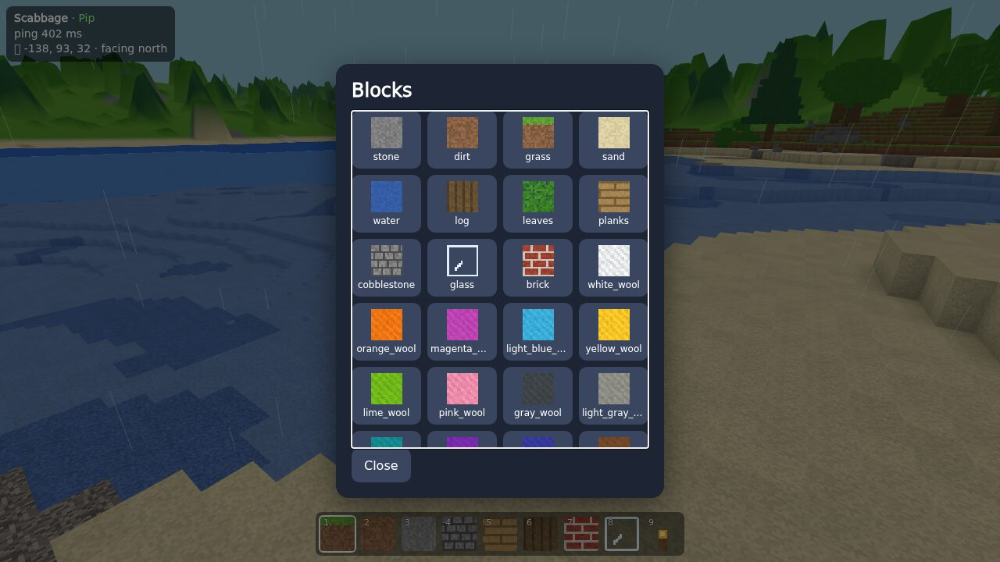

# Scabbage

A family voxel game that runs in the browser. A small group (2–6 players) shares one persistent
world that you host yourself. You can build in it, survive, wire up logic circuits, make
minigames, write scripts with Blockly or Lua, and play adventures.

The server is one small Go binary with SQLite and the client built in. It runs comfortably on a
home server with 2 GB RAM and 2 cores, and does almost nothing while nobody is playing.



## Features

- **Building:** a seeded, bounded world with meter-sized blocks, brush sizes, glass, lights,
  stairs, slabs, wool and family-painted custom blocks.
- **Survival:** health, mining time per block, inventory, crafting, animals and night monsters.
  Protected zones (such as spawn) stop griefing, and each zone or player can be creative or
  survival.
- **Logic:** wire, switches, buttons, plates, gates, relays, toggles, sensors, pistons, doors,
  timers, teleporters and note blocks.
- **Minigames:** arenas with teams, goals and timers, plus built-in race, capture-the-flag, tag,
  spleef and last-one-standing. PvP happens only inside arenas.
- **Scripting:** Blockly for kids and text Lua for older players, run in a sandbox on the server.
- **Adventure:** quests, NPCs, dungeons, loot, bosses and family-made adventure maps.
- **Looks:** each player picks how the world is drawn, from the default to pastel, clay,
  ink & cel, watercolor and more. Weather and a day–night cycle are the same for everyone.
- **Social:** text chat, emotes and blocky avatars with skins you paint yourself.

The same shore in six of the looks:

| Today                                                   | Watercolor                                            | Ink & Cel                                                   |
| ------------------------------------------------------- | ----------------------------------------------------- | ----------------------------------------------------------- |
|                |    |          |
| **Clay Diorama**                                        | **Dusk Pastel**                                       | **Felt & Stitch**                                           |
|  |  |  |

## Run it with Docker

```sh
git clone https://github.com/jmeekerdev/scabbage.git && cd scabbage
docker compose up -d            # pulls the latest released image
docker compose logs scabbage   # shows the one-time admin code
```

Open `http://<host>:8080`, join with the admin code, and you're the first admin. Then, in game:

- type `/invite` to make a link for each family member;
- when they open it, let them in from the toast that appears.

**HTTPS** is optional but recommended away from home: it enables PWA install and the gamepad. Point
a domain at the machine and run

```sh
SCABBAGE_DOMAIN=game.example.org docker compose --profile tls up -d
```

Caddy then fetches a certificate.

**Settings:** to change the world name, game mode, backups, ports, limits or the data folder, copy
[`.env.example`](.env.example) to `.env`, edit it, and run `docker compose up -d` again. Every
setting is also a flag on the binary (`scabbage-server -help`).

**Updating:** run `docker compose pull && docker compose up -d`. To stay on one release, set
`SCABBAGE_VERSION` (such as `v0.1.3`) in `.env`. To run your own changes, use
`docker compose up -d --build`.

**Without Docker:** download the `scabbage-server` binary for Linux, macOS or Windows from
[Releases](https://github.com/jmeekerdev/scabbage/releases) and run it. It keeps the world in
`./data` and serves the game on port 8080.

**Backups:** the world lives in the `scabbage-data` volume. A nightly copy goes into its
`backups/` folder, and the last 7 are kept by default.

## Playing

| Key               | Action                                                                  |
| ----------------- | ----------------------------------------------------------------------- |
| WASD, Space       | Move and jump (double-tap Space or press F to fly in creative)          |
| Mouse             | Look; left-click breaks, right-click places, middle-click picks a block |
| Enter, `T` or `/` | Chat and commands; Tab completes a command                              |
| `B`               | Blocks                                                                  |
| `E` (hold)        | Emotes                                                                  |
| `Q`               | Quests                                                                  |
| `G`               | Next brush size                                                         |
| `R`               | Script the block you are looking at                                     |
| Esc               | Release the mouse                                                       |



Type `/help` in game for the full list. Some useful commands:

- `/settings` and `/blocks`: menus.
- `/create`: paint a block or make a look.
- `/buttons`: show the on-screen menu buttons.

Admins also get:

- `/invite`
- `/approve`, `/deny`
- `/admin`, `/unadmin`
- `/creative`, `/survival`
- `/zone`, `/arena`
- `/tp`
- `/map`, `/world`

Admins can also manage players from `/admin.html`.

Gamepads are supported. Phones and tablets aren't a target right now.

## Development

The dev tools come from [`shell.nix`](shell.nix): Go, Node 22, buf, golangci-lint and glslang.
Without Nix, install those yourself.

```sh
nix-shell
make dev      # Go server on :8080 and a hot-reloading client on :5173
make check    # formatting, lint, type checks, and Go and client tests
make build    # one static binary with the client inside: bin/scabbage-server
make gen      # regenerate Go/TS code after editing proto/
```

Development is test-first: every change ships with tests, and `make check` must pass. Changes go
through pull requests, and CI runs `make check` on each one.

Every merge to `main` is released automatically as the next patch version:

- the release has binaries for six platforms;
- the image `ghcr.io/jmeekerdev/scabbage` gets that version's tag and `latest`.

The major and minor numbers come from [`VERSION`](VERSION). Change it, say to `0.2`, to start the
next series at `v0.2.0`.

```
proto/     Protobuf schema for the WebSocket protocol (source of truth)
server/    Go: cmd/scabbage-server and internal/ packages (gateway, sim, world, logic, mobs, …)
client/    TypeScript + Three.js + Vite: src/ (net, render, world, looks, ui, editor, …)
docker/    Dockerfile and Caddyfile
docs/      PLAN.md: design decisions and the phase-by-phase plan
```

## License

[MIT](LICENSE)
