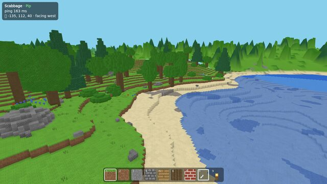
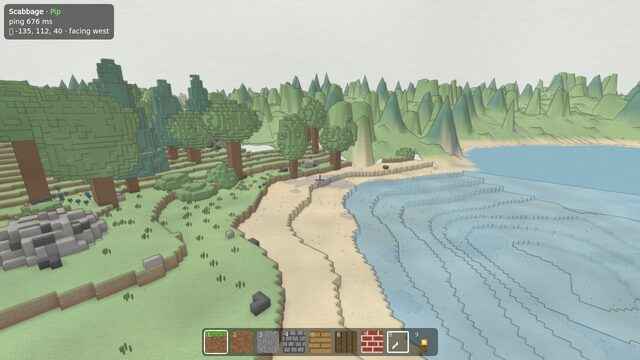
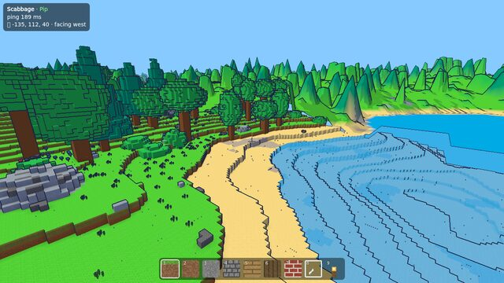
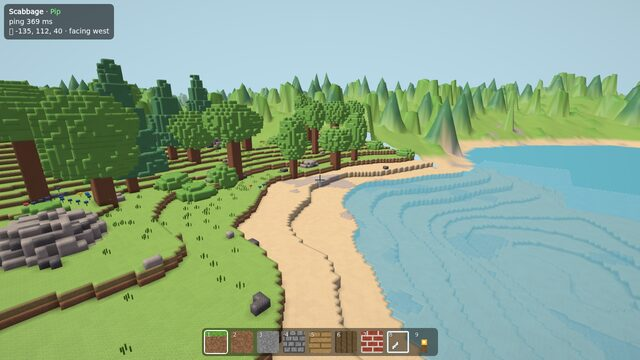
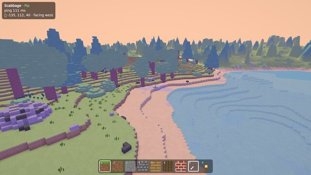
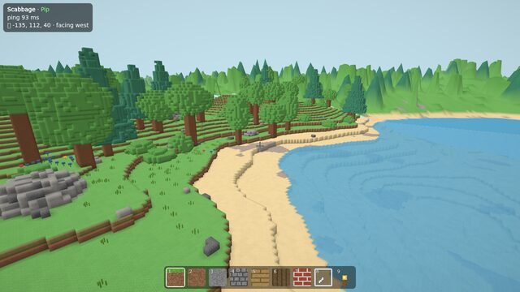

# Looks

Each player picks how the world is drawn, in **Settings → Look**. It only changes your screen.
Everyone shares the same world, time and weather.

| Look            | About                                               |
| --------------- | --------------------------------------------------- |
| Today (default) | crisp pixel blocks                                  |
| Smooth Clay     | rolling hills with crisp built blocks               |
| Clay Diorama    | soft molded colors with rounded edges, like a model |
| Dusk Pastel     | flat pastel faces, warm sun and lilac shade         |
| Felt & Stitch   | fuzzy fabric with stitched edges                    |
| Ink & Cel       | bright cartoon colors with ink lines                |
| Watercolor      | drifting washes on paper with pencil lines          |

Each look's label says if it's slower to draw. If the game feels slow, choose **Today** or turn
graphics down in Settings. Switching to a look with rounded edges redraws the whole world, so it
fades out for a few seconds.

The same shore in six of the looks:

| Today                                                 | Watercolor                                          | Ink & Cel                                                 |
| ----------------------------------------------------- | --------------------------------------------------- | --------------------------------------------------------- |
|                |    |          |
| **Clay Diorama**                                      | **Dusk Pastel**                                     | **Felt & Stitch**                                         |
|  |  |  |

Your skin, painted with `/create` → 🧑 My look, is something else: it's how _you_ look to
everyone. See [Building](building.md#paint-your-own-blocks).

To make a new look, see [Development](../dev/development.md#looks).
